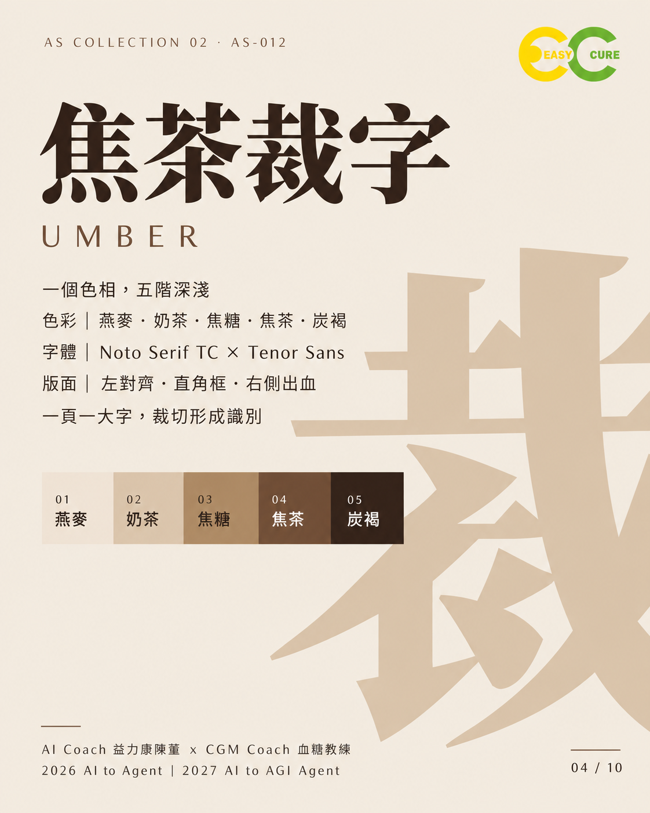
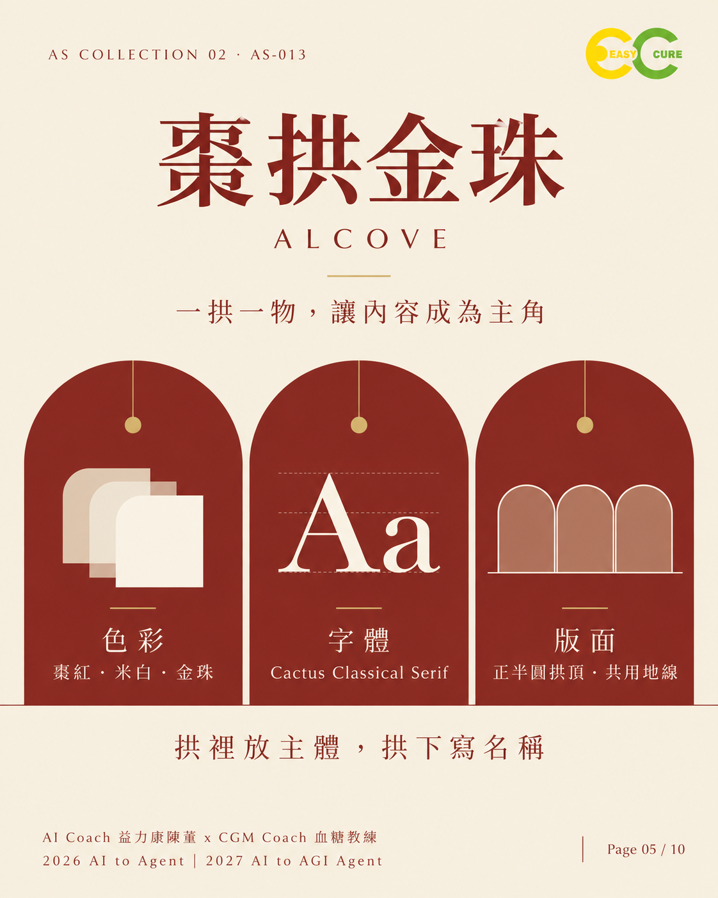
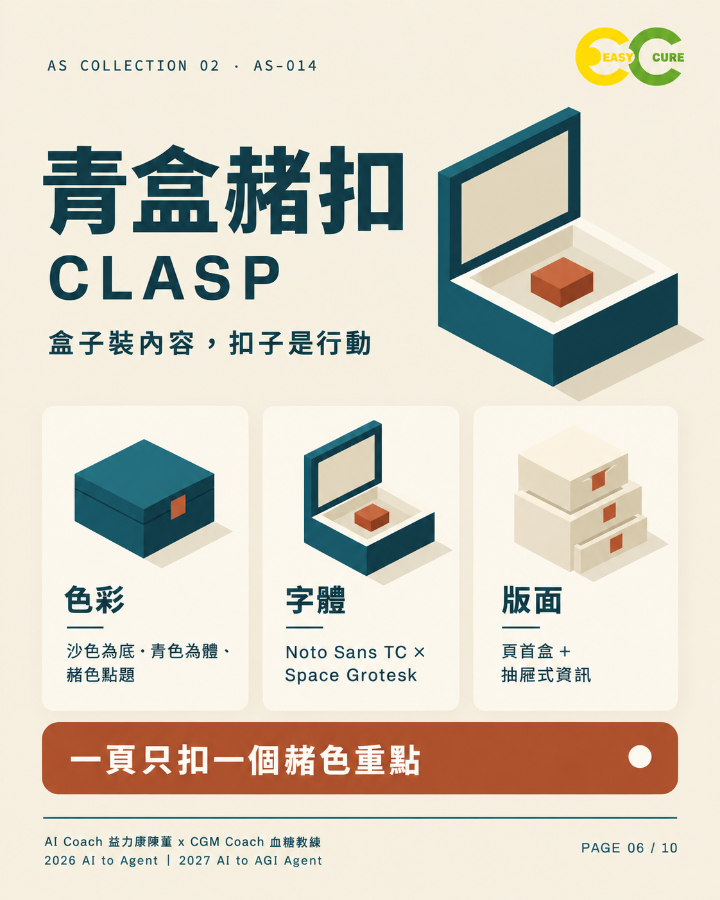
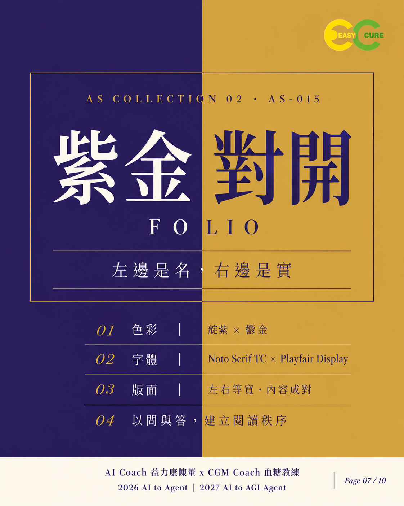
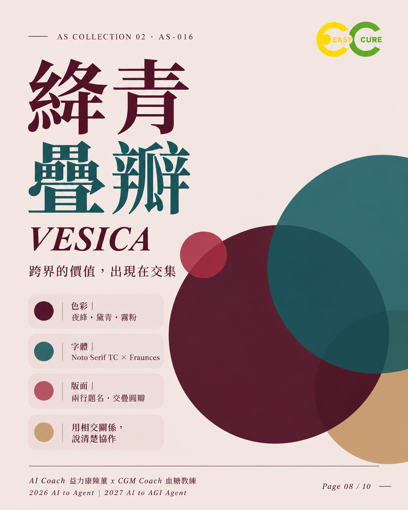
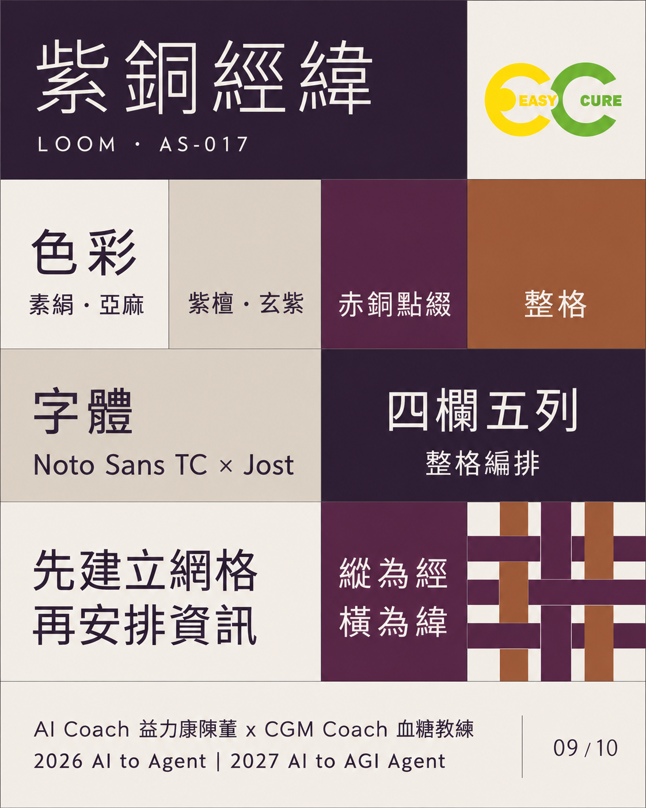

# AS Collection 02

第二批九套風格，AS-010～AS-018；圖卡01為封面，02～10依序介紹九套。

| 風格 | 預覽 | 規格與指令 |
|---|---|---|
| **AS-010 澄光琉璃** LUMIFLOW |  | [規格](styles/AS-010/SPEC.md) · [指令](styles/AS-010/PROMPT.md) |
| **AS-011 莓紫緞結** KNOT |  | [規格](styles/AS-011/SPEC.md) · [指令](styles/AS-011/PROMPT.md) |
| **AS-012 焦茶裁字** UMBER |  | [規格](styles/AS-012/SPEC.md) · [指令](styles/AS-012/PROMPT.md) |
| **AS-013 棗拱金珠** ALCOVE |  | [規格](styles/AS-013/SPEC.md) · [指令](styles/AS-013/PROMPT.md) |
| **AS-014 青盒赭扣** CLASP |  | [規格](styles/AS-014/SPEC.md) · [指令](styles/AS-014/PROMPT.md) |
| **AS-015 紫金對開** FOLIO |  | [規格](styles/AS-015/SPEC.md) · [指令](styles/AS-015/PROMPT.md) |
| **AS-016 絳青疊瓣** VESICA |  | [規格](styles/AS-016/SPEC.md) · [指令](styles/AS-016/PROMPT.md) |
| **AS-017 紫銅經緯** LOOM |  | [規格](styles/AS-017/SPEC.md) · [指令](styles/AS-017/PROMPT.md) |
| **AS-018 青釉金繕** CELADON & GILT |  | [規格](styles/AS-018/SPEC.md) · [指令](styles/AS-018/PROMPT.md) |

[完整規格](SPECIFICATION.md) · [未決問題](OPEN-QUESTIONS.md) · [來源索引](sources/manifest.json) · [介紹圖卡](cards/README.md) · [完整介紹](../../docs/SOCIAL-POST.md)

[上一批：AS Collection 01](https://github.com/draiagent/ai-to-agent-style-systems) · [系列入口](https://github.com/draiagent/ai-to-agent-style-systems)

AI Coach 益力康陳董 x CGM Coach 血糖教練 | 2026 AI to Agent | 2027 AI to AGI Agent
